# Clinical Appointment Booking Platform — Frontend

This is my ITI graduation project, a web application designed to simplify the process of booking and managing clinic appointments.Patients can easily book appointments online, view their upcoming and previous visits, and access their prescriptions, while clinic staff can manage appointments, organize the patient queue, and handle daily clinic operations through a dedicated dashboard.

I built / deployed the backend already before , so I took the chance to integrate and built this frontend for it.

The frontend was built using React with JavaScript (JSX) and Tailwind CSS v4, with a focus on creating a modern, responsive, and user-friendly experience. It connects to a Node.js and Express REST API to handle authentication, appointment booking, patient records, prescriptions, and clinic management.

## Screenshots

Here are some screenshots showcasing the main pages and features of the application.

### Landing Page

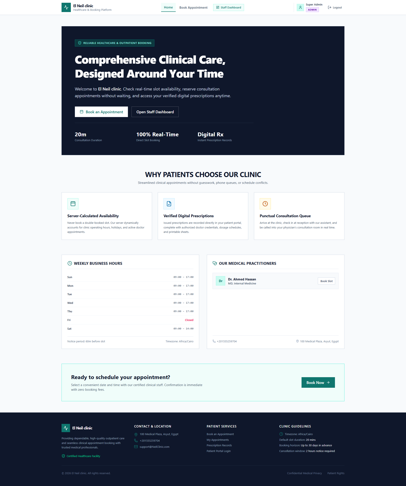

### Patient Portal
Booking appointment , user can view available doctors and book appointment depending on available slots , clinic working hours , and existing appointments
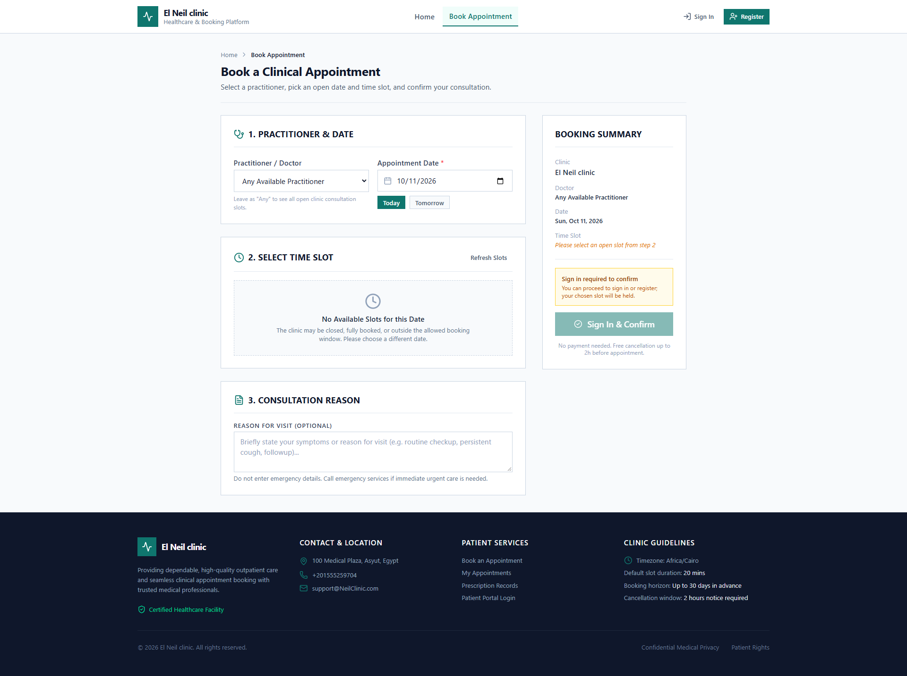

Appointments history , user can view all previous appointments , including cancelled or completed ones , and access their prescriptions from there
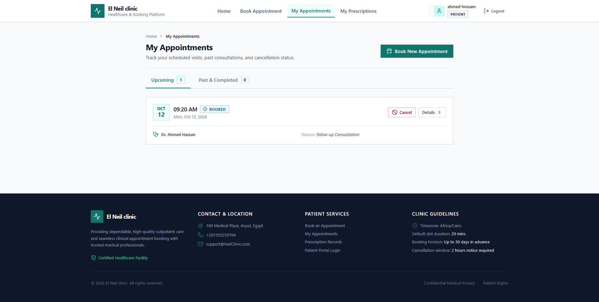

Appointment details , user can view appointment details and access prescriptions
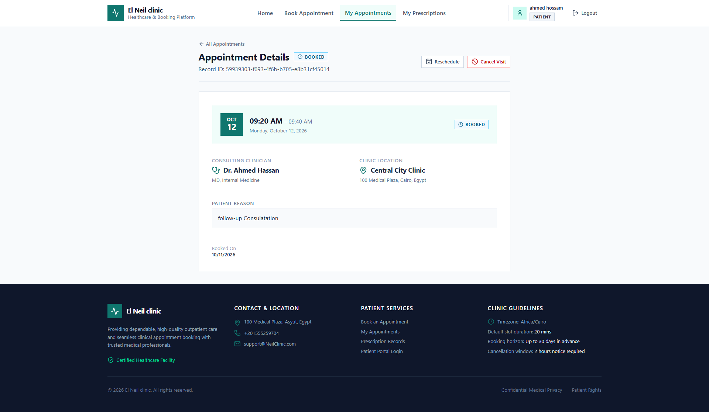

Prescription detail , user can view prescription details and print it
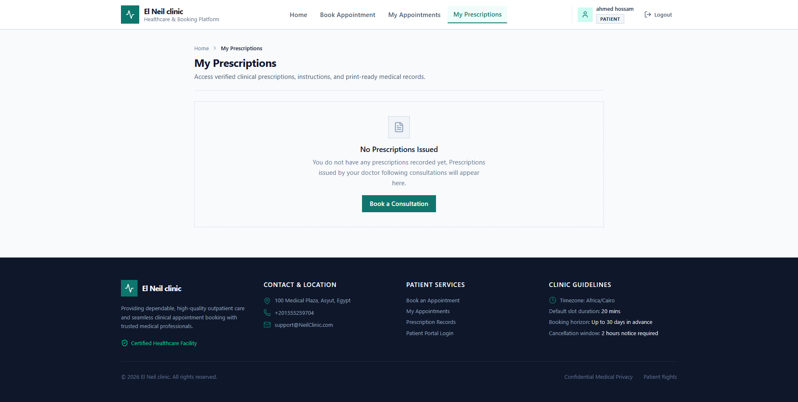

### Staff Dashboard
login screen with pre defined accounts for demo purposes , so you can test it directly without creating an account
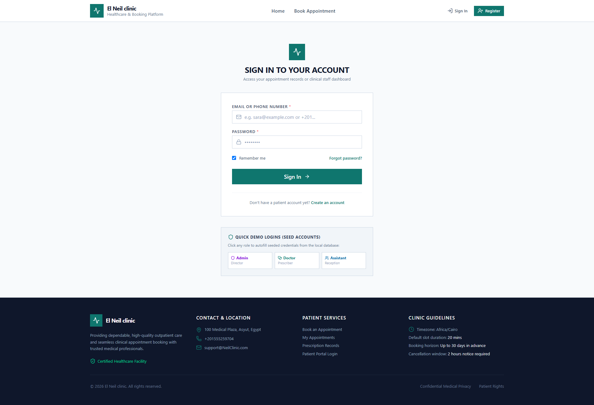

dashboard overview for admin, doctor assistant , they all share the same dashboard overview but with different data/permissions
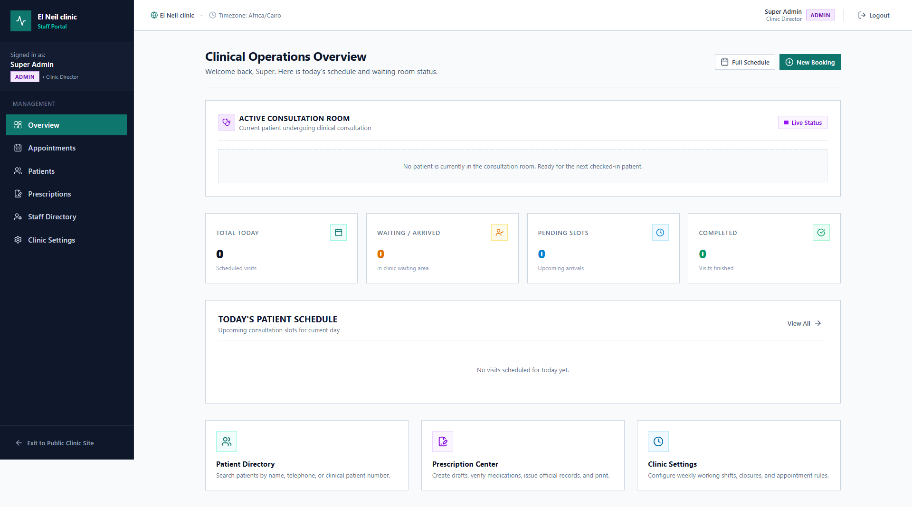

appotiment list for admin , doctor , assistant , admin can view all appointments , doctor can view their appointments only , assistant can view all appointments but can only edit assistant related fields & mark patients as checked in , and start consultation room (for doctor easy access)
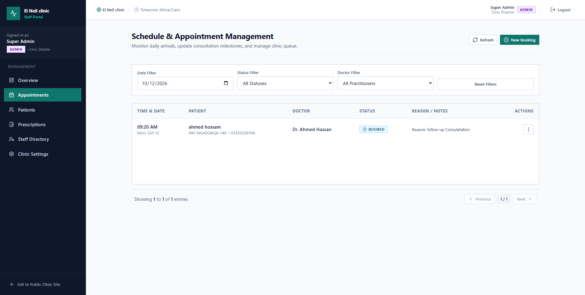

### Clinic Management
clinic settings , admin can edit clinic settings like clinic name,address, email, working hours , holidays , etc
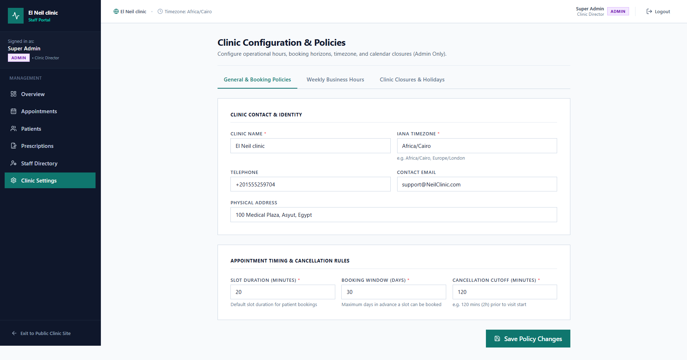

prescription issue , doctor can issue prescriptions , prescriptions include patient info , doctor info , date , time , diagnosis , medications , notes , etc
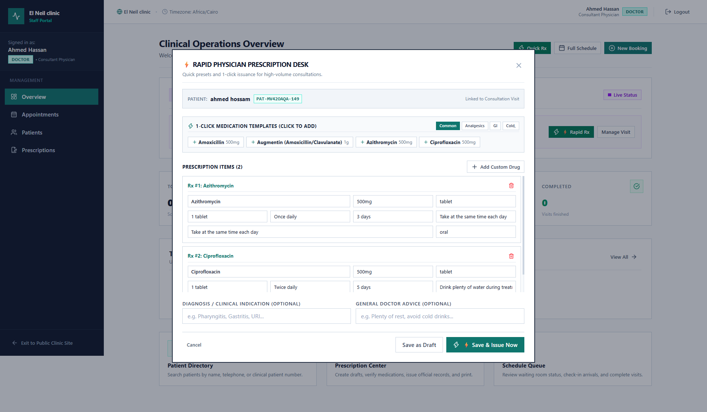

prescription print , assistant or doctor can print prescription in a nice pdf format
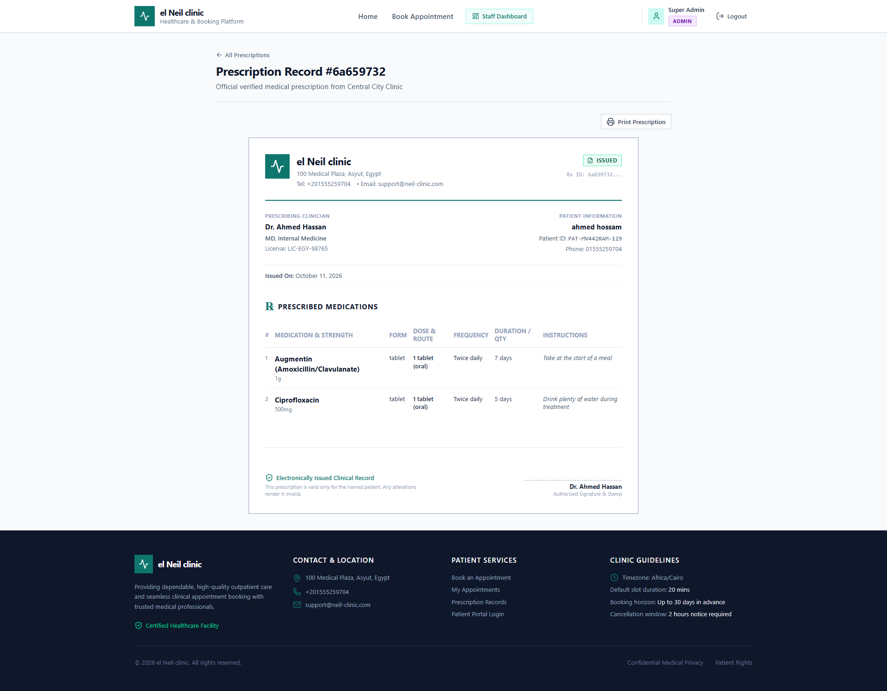

## Main Features

The application provides a complete experience for both patients and clinic staff. Patients can create accounts, log in using their email or phone number, book appointments through a step-by-step process, check available time slots, reschedule or cancel appointments, and view their prescriptions in a printable medical document format.

The staff dashboard makes daily clinic operations easier by providing an overview of appointments and consultations, appointment scheduling, patient search, and queue management. Staff can check patients in, call them in for consultations, update appointment statuses, and prepare prescriptions. Physicians have access to clinical notes and prescription issuance, while administrators can manage staff accounts and configure clinic settings, working hours, appointment durations, and holidays.

The application also includes role-based access for administrators, physicians, assistants, and patients, ensuring that each user has access to the features relevant to their role. Appointment availability is calculated by the backend, taking clinic working hours, closures, and existing bookings into account.

## Technology Stack

The frontend uses React 19 with JavaScript (JSX), Vite for development and building, Tailwind CSS v4 for styling, React Router DOM v7 for navigation, and Lucide React for icons. Inter is used as the main font to maintain a clean and consistent interface.

The application communicates with the backend through its REST API, with the API base URL configured using environment variables.

## Design

The interface uses a clean medical-inspired design with teal as the primary brand color, light backgrounds, white cards, and subtle borders. The layout is designed to remain responsive across different screen sizes, with clear navigation, readable typography, consistent spacing, and distinct status indicators for appointments and prescriptions.

The main colors are teal (`#0F766E`) for primary actions, light gray (`#F8FAFC`) for page backgrounds, white (`#FFFFFF`) for cards and surfaces, and dark slate (`#0F172A`) for primary text. Green, amber, and red are used to distinguish success, in-progress, and error states.

## Getting Started

To run the frontend locally, make sure Node.js and npm are installed. Open a terminal in the `Frontend` directory and install the required dependencies:

```bash
npm install
```

Create a `.env` file in the same directory and configure the backend API URL:

```env
VITE_API_BASE_URL=http://localhost:3000/api/v1
```

Start the development server with:

```bash
npm run dev
```

The application will normally be available at `http://localhost:5173`.

To create a production build, run:

```bash
npm run build
```

Make sure the backend is running and accessible at the configured API URL for features that require server data.

## Test Accounts

If you are using the seeded backend database, you can sign in with the following accounts to explore the different user roles.

| Role      | Email                          | Password               |
| --------- | ------------------------------ | ---------------------- |
| Admin     | `admin@clinic.example.com`     | `SecureClinicPass123!` |
| Doctor    | `doctor@clinic.example.com`    | `SecureClinicPass123!` |
| Assistant | `assistant@clinic.example.com` | `SecureClinicPass123!` |

You can also create a patient account through the registration page. The login page includes demo login options for quickly exploring the application without manually entering the test credentials.

---

**ITI Graduation Project** — Clinical Appointment Booking Platform
